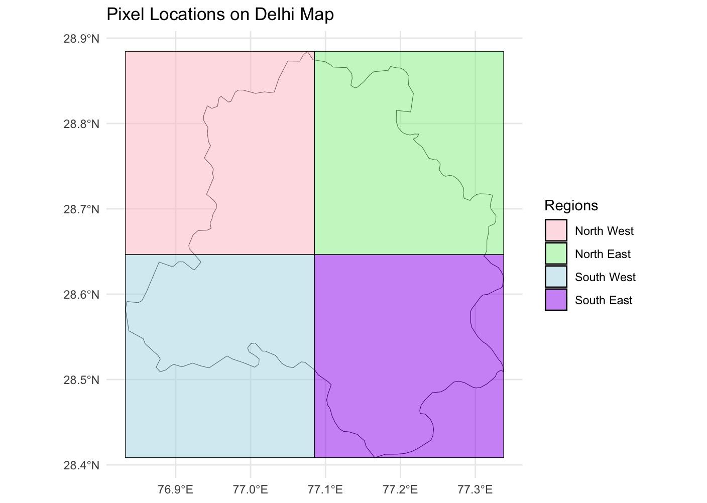
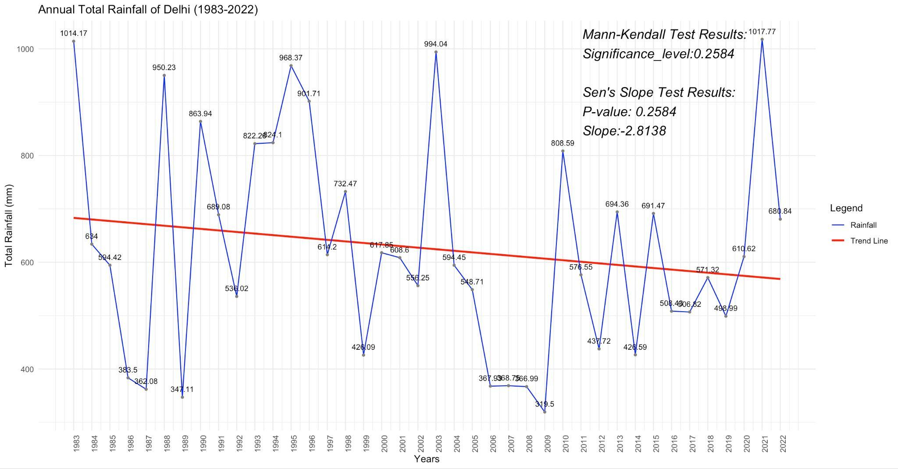

# Long-Term Rainfall Trend Analysis over Delhi (1983–2022)

Has rainfall in Delhi changed over the last 40 years? This project tests for trends in annual rainfall, rainfall extremes, rainy-day frequency and intensity, and compares trends across the four IMD grid pixels that cover Delhi and across overlapping time windows. The analysis is written in R. It was carried out as an MSc Geoinformatics minor project at TERI School of Advanced Studies.

**Short answer:** there is no statistically significant trend in Delhi's total annual rainfall over 1983–2022 (Mann–Kendall p = 0.26). The picture is more varied underneath: the northern part of Delhi shows significant decreases, and two of the four sub-periods do too.

## Objectives

- Analyse trends in rainfall using statistical methods, 1983 to 2022
- Examine the spatial distribution of rainfall patterns in Delhi
- Investigate long-term trends in the intensity and frequency of rainfall over Delhi
- Conduct a comparative analysis of rainfall trends across different time periods

## Data

- **IMD 0.25° × 0.25° gridded daily rainfall**, India Meteorological Department (Pune), 1983–2022
- Delhi is covered by **four grid pixels** (centres at 77.00°E and 77.25°E, 28.50°N and 28.75°N), treated as four regions: North West, North East, South West, South East
- The raw NetCDF files are not stored here. See [`data/README.md`](data/README.md) for the download link, file details and citation.



## Methods

| Method | What it does |
|---|---|
| **Mann–Kendall test** | Non-parametric test for a monotonic trend. The null hypothesis is "no trend"; p < 0.05 is treated as significant. |
| **Sen's slope** | Median of all pairwise slopes. It gives the size of the trend (units per year) and is robust to outliers. |

Both are run in R with the `Kendall` and `trend` packages. Series analysed:

- **Annual total rainfall** (calendar year, January–December) for Delhi, taken as the average of the four pixels' annual totals, and for each pixel
- **10th and 90th percentile of daily rainfall** for each year (low and high rainfall). Only wet days (> 0 mm) are used, pooled over the four pixels; including dry days would make the 10th percentile 0 every year.
- **Frequency:** light rainy days (≥ 1 mm, averaged over the four pixels) and heavy rainy days (≥ 50 mm, counted as a total over the four pixels)
- **Intensity:** Simple Daily Intensity Index (SDII, total rainfall ÷ number of days ≥ 1 mm), maximum 1-day rainfall (Rx1day) and maximum 5-consecutive-day rainfall (Rx5day)
- **Sub-periods:** annual total rainfall over 1983–2008, 1988–2013 and 1993–2018 (26 years each) and 1998–2022 (25 years)

## Key findings

All results are at the 0.05 significance level. The full table is in [`results/results_summary.csv`](results/results_summary.csv).

| Analysis | MK p-value | Sen's slope | Result |
|---|---|---|---|
| Annual total rainfall, Delhi (1983–2022) | 0.2584 | −2.81 mm/yr | No significant trend |
| 10th percentile of daily rainfall | 0.0911 | −0.0016 mm/yr | No significant trend |
| 90th percentile of daily rainfall | 0.395 | −0.0701 mm/yr | No significant trend |
| **North West Delhi** | **0.0169** | **−8.17 mm/yr** | **Significant decrease** |
| **North East Delhi** | **0.01** | **−7.58 mm/yr** | **Significant decrease** |
| South West Delhi | 0.2684 | +3.85 mm/yr | No significant trend |
| South East Delhi | 0.9535 | −0.34 mm/yr | No significant trend |
| Light rainy days (≥ 1 mm) | 0.6494 | −0.077 days/yr | No significant trend |
| Heavy rainy days (≥ 50 mm) | 0.4786 | 0 days/yr | No significant trend |
| SDII | 0.3453 | −0.037 mm/day per yr | No significant trend |
| Maximum 1-day rainfall | 0.4629 | −0.24 mm/yr | No significant trend |
| Maximum 5-day rainfall | 0.1269 | −1.50 mm/yr | No significant trend |
| Annual total, 1983–2008 | 0.1029 | −10.79 mm/yr | No significant trend |
| **Annual total, 1988–2013** | **0.0275** | **−13.69 mm/yr** | **Significant decrease** |
| **Annual total, 1993–2018** | **0.012** | **−11.88 mm/yr** | **Significant decrease** |
| Annual total, 1998–2022 | 0.8701 | +0.92 mm/yr | No significant trend |

**Takeaways**

1. Delhi's total annual rainfall shows large year-to-year swings but no significant long-term trend.
2. Both low and high daily-rainfall extremes lean downward, but not significantly.
3. The significant declines are in the **northern** pixels (North West and North East); the southern pixels show no significant change.
4. The result depends on the time window: 1988–2013 and 1993–2018 show significant declines, while 1983–2008 and 1998–2022 do not. Short windows can mislead, so long records matter.
5. Frequency of rainy days and rainfall intensity show no significant trend.



All result plots are in [`results/figures/`](results/figures/). In these plots, the "Significance_level" label is the Mann–Kendall p-value, and the red line is an ordinary least-squares line for visual guidance (the reported trend size is Sen's slope).

## Repository structure

```
.
├── README.md
├── R/
│   └── helpers.R                       # shared settings, trend tests, plotting
├── scripts/
│   ├── 00_run_all.R                    # runs scripts 01-06 and 08
│   ├── 01_prepare_delhi_data.R         # cut the 4 Delhi pixels out of the IMD files
│   ├── 02_annual_total_trend.R         # annual total, full period + sub-periods
│   ├── 03_regional_trends.R            # annual total per pixel / region
│   ├── 04_percentile_trends.R          # 10th and 90th percentile of daily rainfall
│   ├── 05_rainy_days_trend.R           # light and heavy rainy days
│   ├── 06_intensity_indices_trend.R    # SDII, Rx1day, Rx5day
│   ├── 07_annual_rainfall_map.R        # quick-look map of India (separate from the trend analysis)
│   └── 08_check_against_reported.R     # compares new results with the table above
├── data/
│   └── README.md                       # how to download the IMD data
└── results/
    ├── results_summary.csv             # reported results in one table
    └── figures/                        # reported trend plots
```

## How to run

1. Download the 40 yearly IMD NetCDF files (1983–2022) into `data/` (see [`data/README.md`](data/README.md)).
2. In R, install the packages once:
   `install.packages(c("ncdf4", "ggplot2", "Kendall", "trend", "zoo", "raster"))`
3. Set the working directory to the repository root and run everything:
   `source("scripts/00_run_all.R")`
   or run the scripts one by one, starting with `scripts/01_prepare_delhi_data.R`.

Plots are saved to `outputs/figures/` and result tables to `outputs/tables/`. The last step, `08_check_against_reported.R`, compares the new results with `results/results_summary.csv` and prints MATCH or DIFFERENT for each analysis.

`07_annual_rainfall_map.R` is separate: it draws total annual rainfall over India for one year (change `year` at the top of the script).

## Limitations and possible extensions

- IMD gridded data is interpolated from stations. Delhi spans only four 0.25° pixels, so regional results are coarse. Comparing with station records (Safdarjung, Palam, Ridge) would be a useful check.
- The Mann–Kendall test assumes independent observations. Testing for serial correlation, or using a modified Mann–Kendall test, would strengthen the results.
- Light rainy days are averaged over the four pixels while heavy rainy days are counted as a total; using one convention for both would make them directly comparable.
- Rainfall trends could be linked to land-use change or temperature trends over the same period.

## References

- Rana, A., Uvo, C. B., Bengtsson, L., & Parthasarathy, B. (2012). Trend analysis for rainfall in Delhi and Mumbai, India. *Climate Dynamics, 38*(1–2), 45–56. https://doi.org/10.1007/s00382-011-1083-4
- Jain, S. K., & Kumar, V. (2012). Trend analysis of rainfall and temperature data for India. *Current Science, 102*(1), 37–49. http://www.jstor.org/stable/24080385
- Kumar, V., Jain, S. K., & Singh, Y. (2010). Analysis of long-term rainfall trends in India. *Hydrological Sciences Journal, 55*(4), 484–496. https://doi.org/10.1080/02626667.2010.481373
- Kothyari, U. C., & Singh, V. P. (1996). Rainfall and temperature trends in India. *Hydrological Processes, 10*(3), 357–372. DOI: `10.1002/(SICI)1099-1085(199603)10:3<357::AID-HYP305>3.0.CO;2-Y`
- Rajput, J., Kushwaha, N. L., Sena, D. R., Singh, D. K., & Mani, I. (2023). Trend assessment of rainfall, temperature and relative humidity using non-parametric tests in the national capital region, Delhi. *MAUSAM, 74*(3), 593–606. https://doi.org/10.54302/mausam.v74i3.4936
- Dogra, A., Kumar, C., & Tandon, A. (2023). Utilizing advanced and modified conventional trend methods to evaluate multi-temporal variations in rainfall characteristics over India. *Theoretical and Applied Climatology, 155*(1), 371–397. https://doi.org/10.1007/s00704-023-04640-9
- Pai, D. S., et al. (2014). Development of a new high spatial resolution (0.25° × 0.25°) long period (1901–2010) daily gridded rainfall data set over India and its comparison with existing data sets over the region. *MAUSAM, 65*(1), 1–18.

## Author

[@aarushirrsc-spec](https://github.com/aarushirrsc-spec)
